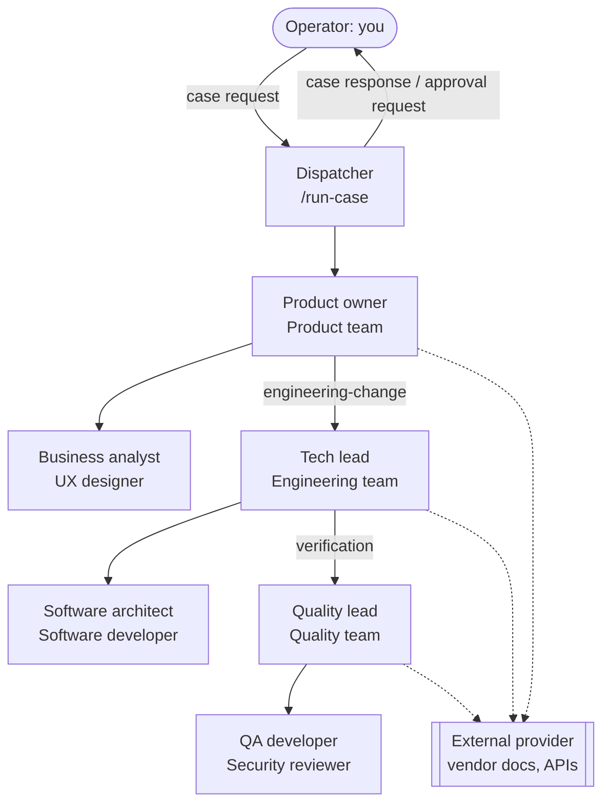

# Tulkas

**Tulkas** is a **framework in which AI agents run an entire operation, with humans only at the boundary**: approvals, judgment calls, physical actions, and real-world information.

The framework is **context-agnostic**: it knows nothing about businesses, stores, or teams. Whatever runs on it is a *context*. This README uses the **software-dev** context as its example: a small software team (product, engineering, quality) that takes a feature request, bug report, or refactor and turns it into a spec, a plan, reviewed code, and a pull request in your repository, with you approving what matters.

**No programming language is used.** The framework runs on [Claude Code](https://code.claude.com) agents and skills that follow Markdown instructions and read and write JSON case files.

## How It Works

You are the **operator**: you open a case with a request, approve the plan, and close the case. Three teams do the work in between, each led by an orchestrator, and they talk to each other only through contracts.



- **The operator** (you, a software engineer) opens a case, e.g. "the invoice total ignores discounts", and receives a **case response**: the deliverable, what blocks it, or the questions still open. You are also the top authority: every escalation ends with you.
- **Orchestrators** (product owner, tech lead, quality lead) plan, delegate, validate outputs against expected outputs and rules, and are the only roles that change state (including commits). They escalate anything outside their authority.
- **Specialists** do one focused job and return an output. The **external provider** stands for an outside vendor and answers from its real documentation; its answers are always validated.
- **The dispatcher** (the main conversation) runs every agent invocation, in parallel when tasks are independent, and logs everything to an append-only event log.
- **All state lives in files**, one writer per file, so every step is auditable.

### A Case, Step by Step

| Step | Who | Produces |
|---|---|---|
| 1. Intake | Product owner | Classifies the request (feature, bugfix, or refactor) and its size (`small` or `standard`) |
| 2. Product documents | Business analyst, UX designer | Spec and PRD (plus an experience design when something people see changes), in product language only |
| 3. Questions | Product owner → you | One request with every open product question |
| 4. Plan | Software architect | A PRP: the only technical document, grounded in your repository's `CLAUDE.md` |
| 5. Plan approval | You | Approve, change, or stop. Nothing is implemented before this |
| 6. Implementation | Software developer | Code on the case branch, committed and pushed by the tech lead |
| 7. Verification | QA developer, security reviewer | An audit and a security review, verified by running the code; the quality lead turns them into pass or fail |
| 8. Delivery | Product owner → you | The deliverable and, with your approval, one pull request |
| 9. Close | You | `/close-case`; you merge the pull request yourself |

Engineering never approves its own work: Product accepts the result only if Quality's verdict passes. A `small` case (an obvious bugfix, a wording change) skips the separate spec and the question round, and asks for the plan and the pull request in one approval.

## Quick Start

Requires [Claude Code](https://code.claude.com) 2.1 or later and `git` (plus `gh` to open pull requests).

1. **Deploy** the framework and contexts to `~/.claude`, from this repository:

   ```bash
   scripts/deploy.sh software-dev
   ```

2. **Prepare** the repository you want to work on. In that repository, run:

   ```text
   /tulkas-init software-dev
   ```

   It checks the repository's `CLAUDE.md` against what the roles need (stack, commands, how to run tests, protected branches), proposes changes, applies them once you approve, and writes `.claude/tulkas.json`.

3. **Open a case**:

   ```text
   /run-case The invoice total ignores line-item discounts; it should subtract them before tax
   ```

   The main conversation becomes the dispatcher. It creates the branch `tulkas/<case-id>` in its own worktree under `.tulkas/worktrees/` (or in your checkout with `--branch`), reports which tasks are running, and brings you each question and approval request. Answer in plain words, e.g. "Approve, and open the pull request when delivered".

4. **Close the case** when you are satisfied (or want to abandon it):

   ```text
   /close-case
   ```

   It commits and pushes the case folder on the case branch. Merging the pull request is up to you. Until you close it, you can keep asking for changes on the same case.

Every case keeps its folder in `docs/tulkas/cases/<case-id>/`, committed with the case: its metadata, the request, the task list, the event log, and the documents (`artifacts/features|bugfixes|refactors|experience|prds|prps|audits/`).

## Other Contexts

Adding a context never requires changing the framework. This repository also holds a **mock firearm store** (`contexts/firearm-store/`), a fully simulated context with six departments, external parties, and mocked records, used to exercise a wide variety of interactions. Its scenarios are in [`contexts/firearm-store/test-scenarios.md`](contexts/firearm-store/test-scenarios.md).

## Repository Layout

```text
CLAUDE.md                     # framework concepts and conventions (start here)
VERSION                       # framework version
scripts/deploy.sh             # deploys the framework and contexts to ~/.claude
.claude/
  agents/                     # one agent per role: spec + expected outputs (software-dev-*.md, ...)
  skills/                     # run-case, close-case, case-protocol, orchestrator-turn, tulkas-init, guides
  rules/<context>/            # enforced rules, auto-loaded when agents touch case data
contexts/
  software-dev/
    CLAUDE.md                 # context guidance: vocabulary, branches, closing a case
    organization.md           # org diagram, interaction matrix, tools, escalation paths
    units/                    # product, engineering, quality, release-ops (inactive)
    interaction-contracts/    # engineering-change, verification, provider-inquiry
    repository-requirements.md  # what a repository's CLAUDE.md must provide
  firearm-store/              # the mock store context
docs/tulkas/                  # case data and mock records of this repository's test runs
runtimes/
  claude-code/README.md       # how the framework maps onto Claude Code
```

## Where to Read Next

| To understand | Read |
|---|---|
| The framework's concepts (operator, roles, authority, escalation, human boundary, cases) | [`CLAUDE.md`](CLAUDE.md) |
| The software-dev context: vocabulary, branches, closing a case | [`contexts/software-dev/CLAUDE.md`](contexts/software-dev/CLAUDE.md) |
| How the teams are organized and talk to each other | [`contexts/software-dev/organization.md`](contexts/software-dev/organization.md) |
| What your repository must provide | [`contexts/software-dev/repository-requirements.md`](contexts/software-dev/repository-requirements.md) |
| How the framework maps onto Claude Code | [`runtimes/claude-code/README.md`](runtimes/claude-code/README.md) |
| How a case is run step by step | [`.claude/skills/run-case/SKILL.md`](.claude/skills/run-case/SKILL.md) and [`.claude/skills/case-protocol/SKILL.md`](.claude/skills/case-protocol/SKILL.md) |

## Status

Version `1.0.0-beta.6`, design and early testing. The software-dev organizational map, guides, and rules are drafted and have run real cases: a multi-screen refactor in a Rails repository and a small bugfix, whose lessons shaped the cost controls and the `small` size class. Not built yet: workflow templates, a task budget per case, resuming an open case after `/clear`, the Release/Ops team, and adapters for other runtimes.
