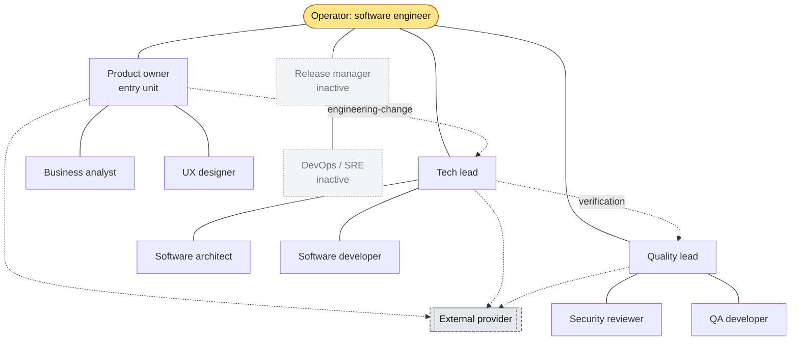

# Software Development Organization

Overview of the software-dev organizational map: hierarchy, interaction matrix, and escalation paths. Details live in:

- `units/`: one file per team (members and what it owns).
- `.claude/agents/software-dev-<role-id>.md`: one agent per active non-human role, with its spec, tools, and expected outputs. The context has no human roles: every human request goes to the operator.
- `interaction-contracts/`: one file per contract.
- `.claude/rules/software-dev/` (rules) and `.claude/skills/software-dev-<guide-id>/` (guides): extension points; expected outputs are in each agent file, and the case response / human request in the `orchestrator-turn` skill.
- [repository-requirements.md](repository-requirements.md): what the repository's own guidance must provide. There is no mock data: cases run against the real repository.

Status: **draft**.

## Organization Diagram

Solid lines are reporting lines. Dotted lines are reached only through a contract. There is no cross-unit orchestrator: the operator holds that function, so every team orchestrator reports to the operator.

| Kind | Roles |
|---|---|
| Operator (not a role) | Software engineer: opens cases, top authority, approver, and the cross-unit orchestrator |
| Cross-unit orchestrator | None (assigned to the operator) |
| Unit orchestrators | Product owner, tech lead, quality lead; release manager (inactive) |
| Specialists | Business analyst, UX designer, software architect, software developer, QA developer, security reviewer; DevOps / SRE (inactive) |
| External parties | External provider (one generic role; each request names the provider it stands for) |
| Human | None |

## Interaction Matrix

Rows request, columns provide. Each cell names the contract. Teams interact only through these contracts and through escalations to the operator.

| Requester ↓ / Provider → | Engineering | Quality | External provider |
|---|---|---|---|
| **Product** | [engineering-change](interaction-contracts/engineering-change.md) | | [provider-inquiry](interaction-contracts/provider-inquiry.md) |
| **Engineering** | | [verification](interaction-contracts/verification.md) | [provider-inquiry](interaction-contracts/provider-inquiry.md) |
| **Quality** | | | [provider-inquiry](interaction-contracts/provider-inquiry.md) |

Requesters and providers are always orchestrators (or the external party). Specialists prepare request content and interpret responses, but only their orchestrator sends, accepts, and applies. Product never asks Quality directly, and Quality answers only Engineering: Product sees Quality's verdict through Engineering's response, which must carry it unchanged.

## Live Integrations and Tools

Specialists call real services (documentation, package registries, APIs) with their own tools when their work needs it; that is a tool use, not a contract. Each agent file lists its tools. The ones that change the repository:

- **Shell** (running the repository's commands, version control): tech lead (environment, commits and pushes of the case branch, the approved pull request and merge), software architect (read-only: reproduce and inspect), software developer, QA developer, and security reviewer (tests, linters, scanners, probes).
- **Editing code in the case workspace**: software developer; QA developer and security reviewer only for throwaway probes, deleted before reporting.
- **Web**: software architect, software developer, security reviewer, external provider.

Roles with the shell prepare the case's environment themselves (start it, install declared dependencies, create or load the test database) within [environment-setup](../../.claude/rules/software-dev/environment-setup.md); only host changes, non-test databases, and anything leaving the machine need the operator.

The product owner, business analyst, UX designer, and quality lead work with files only.

## Escalation Paths

- **Within a team:** specialist → its team orchestrator. Specialists report problems in their output; the orchestrator decides.
- **To the operator:** team orchestrator → operator, for anything outside its authority, failed acceptance after 3 retries, a conflict between teams (e.g., Quality and Engineering disagree on a finding after one round of fixes), or an environment that still cannot run after the allowed setup.
- **Decisions that change the product** (PRP deviations, audit open decisions, scope trade-offs, approval to open the pull request or merge) are not escalated by Engineering or Quality directly: they come back to Product through the contract, and the product owner asks the operator in one request ([deviations-go-to-operator](../../.claude/rules/software-dev/deviations-go-to-operator.md), [push-merge-requires-operator](../../.claude/rules/software-dev/push-merge-requires-operator.md)).

## Case Requests and Responses

The operator opens a case with a request in plain words. Product is the entry unit for every request and classifies it as exactly one task type.

| Request | Entry unit | Task type |
|---|---|---|
| Something the product cannot do today | Product | `feature` |
| The product does something wrong, or fails to do what it promises | Product | `bugfix` |
| Change the inside of the system with no change users can see | Product | `refactor` |

A request holding several work items is split into one case per item, with the operator's agreement. A case stays open for changes until its branch is merged: fixes and changes asked after the deliverable are added to the same case, as new commits on its branch and its pull request. After the merge, anything further is a new case.

A case response is one of:

- **Deliverable**: the change is committed and pushed on the case branch (code and case folder), Quality's verdict passed, and every open decision is answered. It lists the branch, its commits, the pull request (if open), the documents, the verdict, notes, observations outside the case, steps left to the operator, and asks for approval to open the case's pull request or to merge.
- **Blocking findings**: e.g., Quality still fails the change after 3 rounds, or the environment cannot run the tests even after setup.
- **Information needed**: e.g., an open product question, the task type when ambiguous, or a proposed split. The operator answers, and the case resumes.

Before anything is implemented, the operator also gets one **plan approval** request: the PRD in brief, the PRP's approach, and its deviations ([implementation-requires-approval](../../.claude/rules/software-dev/implementation-requires-approval.md)).

## Handoff Scenarios

These illustrate how the contracts connect. They are not workflow templates.

- **Feature, happy path:** the product owner classifies the request and asks the business analyst for the spec. Once it is accepted, the UX designer (when people see or do something new) and then the business analyst for the PRD. With the PRD accepted, Product asks Engineering (`engineering-change`, `implement`). The tech lead prepares the environment of the case workspace (created by the dispatcher), gets the PRP from the architect, accepts it, and returns `plan-ready`; the product owner asks the operator to approve the plan and passes the approval back (`continue`). The tech lead gets the implementation from the developer, commits and pushes it, and asks Quality (`verification`). The quality lead runs the audit and, when the change calls for it, the security review in parallel, and returns `pass`. The tech lead commits the audit, pushes, and returns `delivered`; the product owner sends the deliverable and asks the operator for approval to open the case's pull request. An approved action goes back to Engineering (`engineering-change`, `publish`).
- **Bugfix:** same path. The spec and PRD describe only what the user observes; the architect diagnoses the root cause in the PRP; the developer reports a regression test failing before and passing after; Quality fails the verdict without it.
- **PRP deviation:** the architect's PRP announces a deviation from a PRD requirement. The tech lead accepts the PRP and returns `plan-ready` with the deviation and its options. The product owner puts it in the plan approval request, then sends `engineering-change`, `continue`, with the answer.
- **Change after delivery:** the operator asks for a change on a delivered case that is not merged yet. The product owner revises the product documents if the agreement changes, and sends `continue` with the change; Engineering re-plans only the change (back for approval if the PRP changes), implements it, gets a verification round scoped to it, and pushes new commits to the same branch, which updates the case's pull request.
- **Failed verification:** Quality returns `fail` with blocking findings. The tech lead creates a fix task for the developer, commits and pushes it, and asks Quality for the next round, which audits only the fix diff. After 3 failed rounds on the same findings, Engineering returns `blocked`, and the product owner sends blocking findings to the operator.
- **Provider question:** the architect needs to know a vendor's rate limit and says so in its output. The tech lead sends `provider-inquiry`, validates the answer (only documented or observed claims with a source count), and passes it to the architect's next task.

## Open Questions

- The security review has no document of its own in the case folder; its findings reach the record only through the audit and the verdict. Decide whether it needs its own kind.
- Case bookkeeping written after the tech lead's last commit (its own response, later events, the case response, the publish result, `case-closed`) stays uncommitted. Decide whether a final bookkeeping commit is wanted.
- Which MCP servers, if any, roles may use. Today agents get the shell and web tools only.
- When Release/Ops is activated: who pushes and merges then, and the contract between Engineering and Release/Ops.
